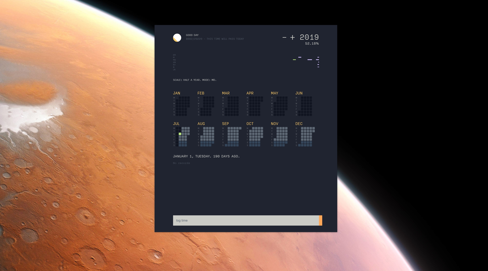

# Jars Desktop

> The desktop version of Jars

#### Build Setup

``` bash
# install dependencies
npm install

# develop locally
npm start

# run the tests
npm test

# build electron application for production
npm run package

```
